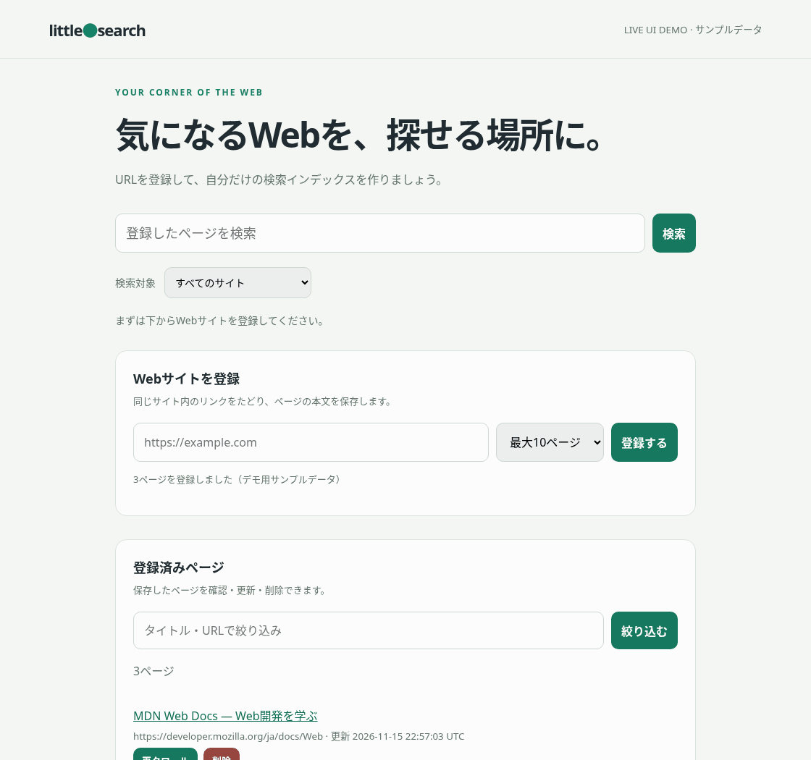

# Little Search

[](https://github.com/rsasaki0109/search_engine/actions/workflows/tests.yml)

**気になるWebを、探せる場所に。**



*実際のUIを使用したデモです。表示内容はサンプルデータです。*

URL登録 → 同一サイトのクロール → 全文検索ができる、小さな検索エンジン。Python標準ライブラリとSQLiteだけで動きます。APIキー・外部パッケージ不要。

## v0.1に向けて

目標は「よく読む5つの技術サイト・500ページから、欲しい情報をすぐ見つける」こと。検索20問中16問を上位5件で見つけることを目指します。[合格基準・評価方法・次の作業](evaluation/README.md)を固定し、`python evaluate.py` で実際の索引を測定します。

最新の実測では5サイト・502ページで、固定20問すべての期待ページが上位5件に入りました。各問3回の中央値で最大約58ms（ローカル検索処理のみ）。[改善内容と測定結果](evaluation/README.md#取得ランキング改善2026-11-17)を記録しています。サイト単位の一括更新と失敗ページの再取得にも対応しています。

現在は性能改善を優先しています。同じ502ページ・27種類の検索を405回実行した比較で、p95は40.3msから6.8msへ改善しました（約5.9倍、逐次・ウォーム状態のローカル検索）。[測定条件・索引追加の費用・次の目標](evaluation/PERFORMANCE.md)を公開しています。

## 起動

Python 3.11以降、SQLite 3.34以降（FTS5/trigram対応）が必要です。

```sh
python app.py
```

http://127.0.0.1:8000 を開いてURLを登録してください。ポート変更は `python app.py --port 8080`。

- サイト単位で保存済みページを一括更新（最大500ページ）、失敗ページだけ再取得
- 更新失敗時は古い本文を保持、失敗URLと理由を永続保存し、成功後に解除
- 登録サイトごとのページ数を表示し、ホスト名の完全一致で検索対象を絞り込み（サブドメインは別サイト）
- クロール停止ボタン（取得中のリクエスト終了後に停止し、保存済みページは保持）
- キャンセルを履歴に記録し、停止完了後は新しいクロールを開始可能
- クロール中のURL・処理件数表示、最近20回の履歴を永続保存
- ページごとの成功・スキップ・失敗理由を表示、再起動時に実行中履歴を中断扱いに更新
- 登録済みページの一覧・タイトル/URLでの絞り込み・更新日時表示
- 1ページずつ再クロール、確認ダイアログ付き削除（クロール中の削除は拒否）
- HTMLのタイトル・本文をSQLiteに永続保存し、再登録時に更新
- 同一ホスト内のリンクを最大30ページ巡回、リクエスト間隔は1秒
- robots.txtに従い、取得できない場合はクロールを中止（404/410は許可）
- FTS5のtrigramと1〜2文字用の転置索引で日本語・短い語を検索
- 空白区切りでAND検索、総件数表示・10件ずつのページ送り、タイトルの単語一致・語順を優先し、同点時はFTSの関連度順（短い語を含む検索ではURL順）
- キーワード付近の本文を抜粋し、一致箇所を強調表示
- 検索語・サイト・ページ番号をURLに保存し、再読み込み・戻る/進む・URLコピーに対応
- ページ・検索索引・クロール履歴をSQLiteバックアップとして保存・復元
- 公開HTTP/HTTPSのみ、取得サイズ4MB・タイムアウト12秒

データは `search.db` に保存されます。停止後に削除すると初期化できます。

## 500ページの収集・評価

```sh
python collect.py
python evaluate.py --output evaluation/local-report.json
```

アプリ停止中に実行します。5つの公式ドキュメントを各100ページまで収集し、途中再開・失敗URLの再試行に対応します。[収集範囲・上限・再開方法](evaluation/README.md)を参照してください。

## 検索結果へのリンク

検索すると `/?q=Python&site=docs.python.org&page=2` のように検索条件をURLへ保存します。再読み込みやブックマークから同じ条件を復元し、ブラウザーの戻る・進むにも対応します。「検索URLをコピー」からURLをコピーできます。コピーが使えない場合はアドレスバーからコピーしてください。

リンクは検索条件を表します。相手側にも同じサービスと索引へのアクセスが必要で、`127.0.0.1` のURLを他の人に送っても、その人から自分のPCには接続できません。ページが更新・削除されると結果は変わり、範囲外のページ番号は補正します。

## サイトの更新・失敗ページの再取得

画面の「サイトを更新」で対象サイトを選び、「保存済みページを一括更新」または「失敗ページだけ再取得」を押します。対象URLのみを取得し、リンクは追加でたどりません。進捗・停止・履歴は通常のクロールと共通です。1回の上限は500ページで、同時実行はできません。

CLI収集中の失敗も画面に表示します。アプリ停止中なら `python collect.py --retry-failed` でも再取得できます。既に各サイト100ページに達していても、失敗URLは再試行します。CLIは `--budget` を接続先ごとの試行上限として使います。HTTP/HTTPSやポートが混在する同じホストの一括処理は、画面では受け付けません。

## 性能測定

```sh
python benchmark.py --rounds 15 --output evaluation/local-performance.json
```

初回はアプリ起動時に、既存の本文から短い語用の索引を構築します。再クロールは不要ですが、構築時間とDB容量が増えます。測定時はアプリと収集CLIを停止してください。p50・p95・p99、問ごとの時間・件数・上位URL、コーパスのハッシュを記録します。

## バックアップ・復元

```sh
# backups/ にUTC日時付きのDBスナップショットを作成
python backup.py create

# 保存先を指定（既存ファイルは上書きしない）
python backup.py create backups/manual.db

# アプリ・収集CLIを停止してから、別のDBファイルへ復元
python backup.py restore backups/manual.db --db restored.db

# 既存の検索DBを置き換えて復元する場合
python backup.py restore backups/manual.db --replace
```

SQLiteのバックアップAPIで、WAL内の確定済みデータを含む整合したスナップショットを作ります。保存済みページ・FTS索引・クロール履歴・失敗一覧・収集候補をまとめて保存します。検査後にだけ保存先へ反映し、作成結果には件数・サイズ・SHA-256を表示します。`--db` で作成元／復元先のDBを変更できます。

復元時はアプリと収集CLIを停止してください。起動中のプロセスを自動検出する機能はありません。復元先にWAL・SHM・ロールバックジャーナルが残っている場合は拒否します。ジャーナルを手作業で削除せず、既存DBをSQLiteで正常に閉じてから再試行してください。既存DBの置き換えには `--replace` が必要で、置き換える前の別バックアップは自動作成しません。

`backups/` はGit管理対象外です。必要に応じて別の保存先へコピーしてください。ファイル整合性とFTS索引を検査しますが、バックアップは信頼できる自分のファイルを使ってください。

## テスト

push・PR時にGitHub ActionsでPython 3.11 / 3.12 / 3.13のテストを実行します。HTTPテストは一時DBとローカルサーバーを使い、外部サイトには接続しません。

```sh
python -m unittest discover -s tests -v
```

ブラウザー操作テストもGitHub Actionsの別ジョブで実行します。ローカルで実行する場合だけ、追加依存とChromiumを用意してください。

```sh
python -m pip install -r requirements-browser.txt
python -m playwright install chromium
python -m unittest discover -s tests -p 'browser_*.py' -v
```

アプリ本体と通常のテストは引き続きPython標準ライブラリのみで動きます。ブラウザーテストも一時DBを使い、外部サイトにはアクセスしません。

## 現在の範囲

個人のローカル利用向けMVPです。JavaScriptで生成される本文、PDF、認証付きページ、定期クロールは未対応。文字コード指定のないページはUTF-8として読み込みます。DNS検証は接続先IPを固定しないためDNS rebindingに対する完全な防御ではありません。信頼できるURLを登録し、サーバーを外部公開しないでください。認証・ジョブ永続化・接続先IP固定などは公開運用前に必要です。
